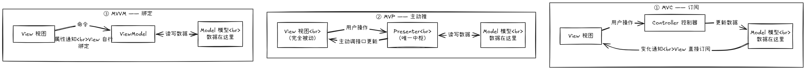

# MVC / MVP / MVVM（三种 UI 架构模式）

> 模块 10。对应实现：`playlist_model.h/.cpp`（MVC 的 Model），`mvp_presenter.h/.cpp`（MVP 的被动 View 接口 + Presenter），`view_model.h/.cpp`（MVVM 的 ViewModel），`main.cpp`（三页签 GUI + 装配接线）。
>
> 运行：`mvc_mvvm_demo.exe` 弹出窗口，三个页签演示同一个「播放器」场景。点各页的「添加曲目」/「下一首」按钮，观察控制台日志；每 5 秒定时器模拟"播完自动切歌"，三页同一时刻各出一行机制日志。

## 核心问题：数据变了，界面怎么知道？

三个模式输入方向完全一样（按钮 → 信号槽 → 调方法），唯一分叉点是**数据回流路径**：

| 模式 | 答案 | 日志证据 |
|------|------|---------|
| MVC | **订阅**：View 订阅 Model 信号，框架自动刷新 | `[MVC-View] 订阅收到 Model 信号` |
| MVP | **主动推**：Presenter 主动调 View 接口（回流零信号） | `[MVP-View] 被 Presenter 主动调用` |
| MVVM | **绑定**：VM 发 NOTIFY 信号，谁 connect 谁收到 | `[MVVM-绑定] 收到属性通知` |

三页**行为契约完全一致**（首曲自动成为当前、下一首环绕、自动切歌），对比只剩「机制」这一个变量——这是本 demo 的第一条纪律：行为不一致时，学员看到的会是行为差异而不是机制差异。

## 三模式差异图

三个模式的角色几乎一样（View、Model、以及一个「中间人」），差别只在**接线方式**——谁认识谁、谁调谁、谁通知谁：



读图要点：
- **MVC**：View **认识 Model**——直接订阅它的变化通知，Controller 只把用户操作翻译成 Model 更新；
- **MVP**：View **只认识 Presenter**（把用户操作转交给它），**不认识 Model**（不知道数据在哪）；Presenter 是唯一中枢——认识 View 接口也认识 Model，所有数据流都经过它；
- **MVVM**：View 只**认识 ViewModel**（调命令、读属性）；ViewModel **不认识 View**——通知发给谁，由 View 自己 connect 决定。

看代码时的关键观察点：
- **MVP**：View 和 Presenter **互相认识**——`MvpPageWidget` 持有 `presenter_` 成员用来转交事件，`PlaylistPresenter` 持有 `IPlaylistView* view_` 用来主动更新；但 View **不认识 Model**（数据不在它手里）；
- **MVVM**：`PlaylistViewModel` 里没有任何 View 指针——它只发信号，谁在听它不知道；
- **MVC**：`QListView::setModel(model)` 一行就完成了订阅，框架替你刷新。

## 三模式对照表（面试背熟）

| | MVC | MVP | MVVM |
|---|---|---|---|
| 数据变了界面怎么知道 | View 订阅 Model（框架信号） | Presenter 主动调 View 接口 | 绑定（NOTIFY 信号）自动同步 |
| 数据在哪 | Model（含全部 UI 状态） | Presenter | Model（经 ViewModel 翻译成属性） |
| **新增一个 View 的代价** | 一行 `setModel` | 改 Presenter：加指针成员 + 每个更新点再调一遍 | 再 connect 一次，ViewModel 零改动 |
| 如何单测 | QSignalSpy 监听 Model 信号 | FakeView 记录调用（Presenter 纯 C++ 无 Qt 依赖） | QSignalSpy 监听 VM 信号，无 GUI 即可测 |
| Qt 对应物 | QAbstractItemModel + QListView | 自写接口 + Presenter | Q_PROPERTY + QML 绑定 |
| 典型适用 | 列表/表格/树（Qt 官方通道） | 业务逻辑重、View 要彻底哑化 | QML、绑定密集、逻辑复杂 |

演进链：MVC 的 View 主动订阅 → MVP 把 View 变被动、Presenter 做中枢（但仍主动调 View）→ MVVM 用绑定让 ViewModel 连 View 都不需要知道。

## 原理（内存层）

- **MVC = 观察者模式**：`QListView::setModel()` 内部把视图的刷新逻辑连到 Model 的 `rowsInserted/dataChanged` 信号。Model 只是数据 + 信号（`beginInsertRows/endInsertRows` 成对调用触发信号），View 只是消费信号的观察者。
- **MVP = 虚函数表调用 + 单一状态源**：Presenter 持有 `IPlaylistView*`，`view_->setCurrent(...)` 是一次虚函数调用，具体 View 换了实现不变。**教训（本仓库旧版的真实 bug）**：旧代码添加曲目时调 `setCurrent(新曲)` 但不更新内部 `current_`——View 显示的"当前"与 Presenter 状态漂移，行为还与 MVVM 分叉。单一状态源是 MVP 的命门。
- **MVVM = 元对象属性表 + NOTIFY + connect**：`Q_PROPERTY` 在元对象系统登记属性描述，NOTIFY 信号在属性变化时发出；绑定方 `connect` 后每次变化收到回调再读 getter。**ViewModel 不持有任何 View 指针——内存上没有反向依赖**。C++ Widgets 里 connect 就是手工绑定；QML 里绑定是语法糖（仅示意，本仓库不建 QML）：

```qml
Text        { text: vm.currentTitle }            // 绑定：自动订阅 NOTIFY + 读值
ListView    { model: vm.titles }
Button      { onClicked: vm.addTrack() }         // 命令
```

## 使用场景与工程选型

- **Qt Widgets 的列表/表格/树** → **MVC（model/view）**：Qt 官方通道，框架帮你刷新，还免费获得多视图、委托生态。绝大多数 Qt 业务数据的展示用这个。
- **QML 界面 / 绑定密集 / 逻辑复杂要无 GUI 单测** → **MVVM**：`Q_PROPERTY + NOTIFY` 就是绑定骨架，ViewModel 可在 QCoreApplication 下单测。
- **业务逻辑重、View 要彻底哑化、需要强测试** → **MVP**：Presenter 只依赖 View 接口（纯 C++），测试传 FakeView 记录调用即可。
- **一句话选型**：Qt 工程 90% 用 model/view（MVC），QML 用 MVVM 风格，MVP 用于"必须把 View 完全 mock 掉"的场景。三者可叠加——ViewModel 可以包一个 QAbstractItemModel。

## 最佳实践

1. **状态单一来源**：MVC 的 Model / MVP 的 Presenter / MVVM 的 VM 各是唯一状态源，任何"顺手直接改 View"都会造成状态漂移（旧版 bug 教训）。
2. **对比实验只留一个变量**：先统一行为契约再对比机制，否则机制差异会被行为差异污染。
3. **自定义 Model 必须成对调用 `beginInsertRows/endInsertRows`**（漏掉则视图崩溃/不同步）；`rowCount/data` 都要做索引越界检查。
4. **Q_PROPERTY 必带 NOTIFY**（QML 绑定的硬性要求）、信号命名 `xChanged`、只读属性不给 WRITE（"View 从不写 ViewModel"）。
5. **Presenter 保持非 QObject**：不依赖 Qt 信号/GUI，可测性收益远超便利性损失。
6. **测试方法**：Model/VM 用 `QSignalSpy`（QCoreApplication 即可）；Presenter 用 FakeView 记录调用序列并断言。

## 面试要点

- **Q1：MVC、MVP、MVVM 的区别？** 一句话：数据回流路径不同。MVC 的 View 主动订阅 Model；MVP 的 View 被 Presenter 主动驱动（回流零信号）；MVVM 靠绑定自动同步（VM 不感知 View）。
- **Q2：Qt model/view 是 MVC 吗？** 是 MVC 的 Qt 实现：QAbstractItemModel=Model，QListView=View，delegate 承担 Controller 的编辑职责；业务代码通过 model 接口操作，View 由框架刷新。
- **Q3：MVP 和 MVVM 的区别？** MVP 的 Presenter 持有 View 接口、主动调它（推）；MVVM 的 ViewModel 只发属性信号、不知道谁在听（订阅）。前者 View 是 Presenter 的参数，后者 View 自己 connect。
- **Q4：什么时候用哪个？** Qt Widgets 列表/表格 → model/view；QML → MVVM；View 必须完全 mock、业务逻辑重 → MVP。model/view 与 MVVM 可叠加（ViewModel 包 Model）。
- **Q5：自定义 QAbstractListModel 必实现哪些接口？** 只读：rowCount/data；可写操作要在 beginInsertRows/endInsertRows 之间完成，漏掉成对调用则视图不同步。
- **Q6：MVVM 的绑定底层是什么？** Q_PROPERTY（getter + NOTIFY 信号）+ connect 订阅。QML 的 `text: vm.currentTitle` 是"订阅 + 读值"的语法糖。
- **Q7：新增一个 View 的代价分别是多少？** MVC 一行 setModel；MVVM 再 connect 一次且 ViewModel 零改动；MVP 要改 Presenter——加 View 指针成员 + 在每个更新点（init/add/next）都再调一遍。
- **Q8：Presenter 状态与 View 显示漂移的后果？** 违背单一状态源：显示与逻辑分裂（如"当前"标签显示曲目2、内部 current 还是 -1，下一首倒退到曲目1），且多 View 时互相矛盾——这正是本仓库旧版代码的真实 bug。

## 演示输出说明

启动时 MVP 页先打两行（初始画面也由 Presenter 推送）：

```
  [MVP-View] 被 Presenter 主动调用: setTitles
  [MVP-View] 被 Presenter 主动调用: setCurrent(  )
```

之后在三页各点「添加曲目」×2、「下一首」，控制台依次出现（每页首次添加时的"当前播放"日志 + 切歌日志）：

```
  [MVC-View] 订阅收到 Model 信号: 当前播放 曲目1
  [MVC-View] 订阅收到 Model 信号: 当前播放 曲目2
  [MVP-View] 被 Presenter 主动调用: setTitles
  [MVP-View] 被 Presenter 主动调用: setCurrent( 曲目1 )
  [MVP-View] 被 Presenter 主动调用: setTitles
  [MVP-View] 被 Presenter 主动调用: setCurrent( 曲目2 )
  [MVVM-绑定] 收到属性通知: 当前播放 曲目1
  [MVVM-绑定] 收到属性通知: 当前播放 曲目2
```

每 5 秒的自动切歌，三页同一时刻各出一行（机制差异的定格画面）：

```
  [MVC-View] 订阅收到 Model 信号: 当前播放 曲目1      ← 订阅
  [MVP-View] 被 Presenter 主动调用: setCurrent( 曲目1 ) ← 主动推
  [MVVM-绑定] 收到属性通知: 当前播放 曲目1             ← 绑定
```
