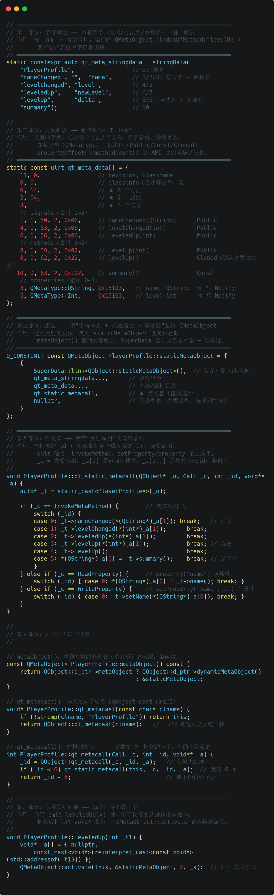

# 模块 11：元对象系统（Meta-Object System）

> 对应实现（接口与实现分离）：`player_profile.h/.cpp`（Q_OBJECT 反射载体），`main.cpp`（五场景演示：MOC 产物 / 元对象表 / 属性系统 / 信号槽 / 反射调用）。

## 来源

Qt 特有机制（非 GoF 23）。1996 Trolltech 引入 MOC（Meta-Object Compiler），核心是**静态代码生成 + 运行时查表**：编译期用 `Q_OBJECT` 宏标记类，MOC 扫描头文件生成一份 `QMetaObject` 静态元数据（类名、继承链、属性表、信号槽表、可调用方法表），运行时通过 `metaObject()` 查这张表——这就是 Qt 的反射。信号槽、Q_PROPERTY、Q_INVOKABLE、QML 绑定、QObject::property() 全部建立在它之上。

**一句话本质**：C++ 语言不给反射（RTTI 只有类型身份，没有成员/方法元数据），Qt 用"方言关键字 + 编译前代码生成"自己造了一份反射——把反射信息在编译期物化成静态常量表，运行时纯查表。代价是一次额外的构建步骤（moc），换来运行时零扫描、确定性、跨平台。

## 用法

```cpp
class PlayerProfile : public QObject {
    Q_OBJECT                                     // MOC 生成元对象表
    Q_PROPERTY(QString name READ name WRITE setName NOTIFY nameChanged)  // 属性入表
public:
    Q_INVOKABLE void levelUp(int delta = 1);      // 方法入表（可字符串调用）
signals:
    void leveledUp(int newLevel);                 // 信号入表
};

// 运行时反射
profile.metaObject()->className();                          // 类型名
meta->property(i).name();  meta->method(i).methodSignature();  // 遍历属性/方法表
profile.setProperty("name", "Jungle");                      // 动态写属性（走 WRITE）
QMetaObject::invokeMethod(&profile, "levelUp", Q_ARG(int, 2));  // 字符串寻址调用
QObject::connect(&profile, &PlayerProfile::leveledUp, ...);     // 信号槽
```

## 使用场景

- **反射与序列化**：遍历属性表把对象 dump 成配置/JSON（不用手写每个字段）；
- **插件系统**：`metaObject()->className()` 识别插件类型、查接口方法（模块 13 的底座）；
- **事件总线 / 命令分发**：`invokeMethod` 按字符串动态调用、跨线程投递命令；
- **QML 绑定**：`Q_PROPERTY + NOTIFY` 是 QML 属性绑定的数据来源（模块 10 MVVM）；
- **编辑器 / 属性面板**：遍历元对象表自动生成属性编辑控件；
- **调试与诊断**：运行时打类型名、方法签名，不用 RTTI。

## 原理（内存层）

### MOC 是什么：编译期代码生成，不是运行时魔法

```
Q_OBJECT 类源码
   │ MOC 扫描（构建时，编译前）
   ▼
moc_player_profile.cpp（自动生成，链接进程序）
   - 字符串池、qt_meta_data 数据表、staticMetaObject（只读段常量）
   - metaObject() / qt_metacall() / qt_static_metacall() / 信号发射函数
```

反射信息**编译期固化**：字符串表、数据表、staticMetaObject 落在程序只读数据段（.rdata 附近），进程内只构造一次、全实例共享。运行时没有任何"扫描"，只有查表 + 跳转。

### MOC 实现过程：预处理 → 词法 → 语法 → 生成

MOC 是独立可执行程序（`moc.exe`，源码在 `qtbase/src/tools/moc/`），四个核心文件构成一条流水线：

```
player_profile.h
   │ ① 预处理（preprocessor.cpp）
   │    展开 #define、处理 #if 条件编译；
   │    故意【不】展开 Q_OBJECT/Q_PROPERTY 等关键宏——要保留宏名给词法层识别
   ▼
   │ ② 词法分析（scanner.cpp）
   │    手写 DFA 扫描器，切 token；识别 Qt 方言关键字（见下节"关键词表"）
   ▼
   │ ③ 语法分析（parser.cpp）→ AST
   │    递归下降，只解析类声明、不解析函数体（见 { 跳过实现）；
   │    signals: 之后的方法 → 信号；slots: 区 → 槽；Q_INVOKABLE → 可调用方法；
   │    Q_PROPERTY → 吃括号参数建属性节点
   │    产出 ClassDef / FunctionDef / PropertyDef / EnumDef / ClassInfoDef
   ▼
   │ ④ 代码生成（generator.cpp）→ moc_player_profile.cpp
   │    按 AST 逐项生成（见下节"产物逐项"）
   ▼
moc_player_profile.cpp → 参与正常编译链接
```

### MOC 产物逐项（对照 moc_player_profile.cpp）

| 生成内容 | 产物里的实际表现 | 语义 |
|---|---|---|
| 字符串池 | `qt_meta_stringdata`：类名/方法名/参数名连续拼接，按**偏移+长度**寻址（Qt 6 用 `QtMocHelpers::stringData`，旧版 `offsetsAndSizes`） | 所有名字一次存储、按索引取用，不建哈希 |
| 数据表 | `qt_meta_data` int 数组：content 头（revision=11、signalCount=3）+ 每信号/方法一行（名称索引、argc、参数 QMetaType、flags）+ 每属性一行 | 就是一份**目录**；继承链通过 `propertyOffset`/`methodOffset` 累加父类数量定位 |
| 元对象 | `PlayerProfile::staticMetaObject`：`SuperData::link<QObject::staticMetaObject>()` + 字符串表 + 数据表 + `qt_static_metacall` 指针 | 只读段常量；SuperData 链 = 继承链反射 |
| 派发函数 | `qt_static_metacall`：`switch(_id)` → `case 0: _t->nameChanged(...)`；`case 5: QString _r = _t->summary(); *_a[0] = std::move(_r);` | `void** _a` 参数数组，`_a[0]` 永远留给返回值——类型擦除的调用桥 |
| 信号发射 | 每个信号一个函数：`void *_a[] = {nullptr, addressof(_t1)}; QMetaObject::activate(this, &staticMetaObject, 0, _a);` | **emit 的本质就是调用这个函数** |
| 实例方法 | `metaObject()`（返回 &staticMetaObject）、`qt_metacast`（按名 strcmp）、`qt_metacall`（先让父类扣索引 `_id -= 6`，剩的归自己） | 索引协议：子类优先、父类靠后 |
| 默认参数克隆 | `levelUp(int)` 与 `levelUp()` 两条方法记录（flags MethodCloned） | 默认参数在元数据里必须展开成独立签名 |
| 信号索引匹配 | IndexOfMethod 段：`&PlayerProfile::nameChanged == *reinterpret_cast<_t*>(_a[1])` | `connect(&X::sig)` 靠成员函数指针比较找索引，不用字符串 |

### 运行时反射链路（内存层）

```
程序加载：staticMetaObject/字符串表/数据表 → 只读段，一次构造，全进程共享
对象创建：vptr 指向本类虚表（QObject 本来就有虚函数，Q_OBJECT 不新增 vptr）
按名反射：invokeMethod("levelUp", Q_ARG(int,2))
          → metaObject()->indexOfMethod("levelUp")：遍历方法表在字符串池里比较（O(n)）
          → 拿到方法索引 → 构造 void* 参数数组 → qt_static_metacall switch → 真身调用
信号发射：emit nameChanged(s) → 信号函数打包 _a[] → QMetaObject::activate
          → doActivate：blockSig 短路 → maybeSignalConnected 位图快路径
          → signalVector->at(index) 定位连接链表 → 遍历：
              同线程 AutoConnection → 直接 callFunction（qt_static_metacall 或槽对象）
              跨线程 → queued_activate：按 QMetaType 拷贝参数进 QMetaCallEvent 投递
```

性能账：直接函数调用约 1–2ns；信号槽直连约几十 ns（**一个数量级以上**）；跨线程排队再加拷贝与事件循环调度。代价全在"类型擦除 + 运行时查表"，不在 MOC 本身。

### QMetaObject 结构（内存视角）

```
QMetaObject（静态实例）
 ├── className        "PlayerProfile"
 ├── superClass        → QObject 的 QMetaObject（继承链）
 ├── 字符串表          属性名/方法签名的字符串池
 ├── 属性表            name/level：READ/WRITE/NOTIFY 索引
 ├── 方法表            leveledUp(信号)、levelUp(槽/方法)、summary(方法)
 └── 索引规则          信号、槽、方法按顺序编号；propertyOffset/methodOffset
                       = 继承来的数量，从 offset 起才是自己声明的
```

- `metaObject()->className()` 查的就是这张静态表；
- `propertyOffset/methodOffset`：继承链上每个类都往表里追加自己的属性/方法，offset 标记"从哪条起是我的"——遍历时 `[offset, count)` 就是本类声明的（场景 2 演示）；
- 对象本身不存元数据——`metaObject()` 是虚函数，返回类的静态表地址，**一个类只存一份表，所有实例共享**（内存零浪费）。

### 信号槽派发路径

```
emit leveledUp(3)
   → 根据编译期算好的信号索引（methodIndex）
   → qt_static_metacall / qt_metacall：查连接表，按索引派发给槽
   → DirectConnection：同线程直接调槽函数
   → QueuedConnection：打包事件投递到接收线程事件循环（跨线程）
```

- 连接在 `connect()` 时建立（信号索引 ↔ 槽函数映射），emit 时按索引查表派发——**比纯虚函数多一次索引查表，这是"信号槽比回调略慢"的来源**；
- 类型安全：信号参数经元类型注册（`QMetaType`）校验，参数不匹配在 connect 时拒绝（Qt 6 部分校验提前到编译期）。

### Q_OBJECT 宏展开与拷贝禁用

`Q_OBJECT` 宏自带 `public:` 和 `private:` 两段访问区切换，核心展开（Qt 6.5）：

```cpp
public:
    static const QMetaObject staticMetaObject;      // moc 生成的 .cpp 里定义
    virtual const QMetaObject *metaObject() const;  // 返回 &staticMetaObject
    virtual void *qt_metacast(const char *);        // 按类名转型
    virtual int qt_metacall(QMetaObject::Call, int, void **);  // 按索引派发入口
    QT_TR_FUNCTIONS                                  // tr() 翻译函数
private:
    Q_DECLARE_HIDDEN_METHODS(...)                    // Qt 内部隐藏辅助声明
    Q_DISABLE_COPY_MOVE(ClassName)                   // 删除拷贝/移动构造与赋值
    friend class QObjectPrivate;
```

- **为什么有 private 段**：放"禁止拷贝 + 隐藏辅助"这些本不该暴露的声明。`Q_DISABLE_COPY_MOVE` 是因为 QObject 是**身份语义**（对象名、parent、信号连接、元对象都绑在具体实例上），拷贝等于复制一份无法复制的身份，故禁用——工程上 QObject 子类用指针/引用或 `std::unique_ptr` 传递；
- **不是"必须放 private 才能编译"**：宏自己会切访问区，放类里任何位置都能工作。

## MOC 实现不好的地方（面试弹药）

1. **登记制，不是全量反射**：只有写进 `Q_PROPERTY`/`signals`/`slots`/`Q_INVOKABLE` 的东西可见；裸成员变量、自由函数、模板方法全都反射不到；
2. **模板类直接废**：MOC 解析不了模板语法（parser 见到 `template` 放弃）；信号/槽参数是 `T` 无法确定 QMetaType 编号；`staticMetaObject` 是模板类静态成员、各实例化共享一份，无法同时服务 `Foo<int>` 和 `Foo<QString>`。本质：**反射是"每个具体类型一份元数据"，模板是"按需生成类型"，登记制代码生成发生在编译前、枚举不了模板实例**。绕过：非模板基类放 Q_OBJECT + 模板子类继承；
3. **构建链脆弱**：头文件一动 → moc 重跑 → 所有依赖 TU 重编；AUTOMOC 只是掩盖；
4. **解析器鲁棒性差**：MOC 不是完整 C++ 解析器（简化预处理器、不解析函数体），`Q_OBJECT` 被复杂宏包裹、非常规写法时报看不懂的错误；
5. **运行时按名查找 O(n)**：`indexOfMethod`/`indexOfProperty` 线性扫描；`invokeMethod` 每次调用都查一遍字符串；
6. **类型擦除**：`void**` 参数数组，类型安全靠运行时 QMetaType 校验；
7. **ABI 版本耦合**：`Q_MOC_OUTPUT_REVISION` 硬编码校验，升级 Qt 必须全量重新 MOC；
8. **元数据冗余**：类名、方法名、参数名在字符串池里重复存储（Qt 6 已优化为单段拼接）。

平衡：优点是确定性强、无运行时扫描开销、错误构建期暴露——这是它能活 20 多年的原因。

## MOC 的关键词表与算法

`scanner.cpp` 里有一张**按字典序排序的静态数组**，约三四十个 Qt 方言关键字：

```cpp
static const Keyword keywords[] = {
    { "Q_CLASSINFO", ... }, { "Q_ENUM", ... }, { "Q_FLAG", ... },
    { "Q_GADGET", ... }, { "Q_INVOKABLE", ... }, { "Q_OBJECT", ... },
    { "Q_PROPERTY", ... }, { "SIGNAL", ... }, { "SLOT", ... },
    { "emit", ... }, { "foreach", ... }, { "forever", ... },
    { "signals", ... }, { "slots", ... }, ...
};
```

**用途**：MOC 是"方言语法"编译器——这些词对编译器是会被展开的宏，对 MOC 是 token 级关键字。scanner 把它们从普通标识符里区分出来（`TOKEN_SIGNALS`、`TOKEN_Q_OBJECT` 等），parser 靠这些标记分流解析：`signals:` 切换信号区、`Q_OBJECT` 决定要不要生成元对象、`Q_PROPERTY` 走属性登记分支。**忘写 Q_OBJECT 就没有信号槽的底层原因**就在这：扫不到 `TOKEN_Q_OBJECT`，整个类被跳过。

**算法分析（是不是最优）**：查找用二分（bsearch/lower_bound），`O(log n)` ≈ 5–6 次比较。

- **不是最优**：完美哈希（gperf 生成）可到 `O(1)`，constexpr 开放寻址哈希表也行；
- **但合理**：只有几十个词，二分 vs 哈希差 6 次比较 vs 1 次哈希；MOC 是离线构建工具，整张表的查询总开销毫秒级——**性能热点不在词法查表**（在 parser 和字符串池分配），优化它是负收益；
- **更该被批评的**：手工 DFA + 二分这套 90 年代实现，关键字表靠人工维护排序；以及运行时 `indexOfMethod` 按名查找是线性扫描（方法数通常 < 50，Qt 一直没建哈希索引，工程判断"没必要"）。

## 现代 C++ / Qt 最佳实践

- **Q_PROPERTY 规范**：getter 用 `const`，WRITE 里值没变就不要 emit NOTIFY（防无谓刷新）；NOTIFY 信号参数与属性类型一致；
- **需要反射才用 Q_OBJECT**：普通工具类不需要元对象就别加（省 MOC 开销）；
- **invokeMethod 用于动态/跨线程调用**：同线程同类型直接用函数指针 connect，别用字符串（快且编译期查错）；
- **遍历元对象表注意 offset**：从 `propertyOffset()/methodOffset()` 开始，否则打印一堆 QObject 继承来的成员；
- **动态属性（setProperty 任意名）**：只存运行时表，Q_PROPERTY 查不到——用于给对象临时挂标记（如权限标签），别当正式字段用；
- **跨线程传自定义类型**：`Q_DECLARE_METATYPE`（编译期声明"可见"）+ `qRegisterMetaType`（运行时登记拷贝/析构）配合，排队才拷得动参数（详见面试 Q6）。

## 面试要点

- **Q1：Q_OBJECT 宏展开成什么？为什么涉及 private 区？**
  展开 = 声明 `staticMetaObject` + `metaObject()/qt_metacast()/qt_metacall()` 三个虚函数 + `tr()` + 私有区隐藏声明和 `Q_DISABLE_COPY_MOVE`。private 段的动机：放"禁止拷贝（QObject 身份语义）+ 内部隐藏辅助"这些不该暴露的声明；宏自带访问区切换，放类里任何位置都能编译。
- **Q2：moc_xxx.cpp 什么时候生成？AUTOMOC 原理？**
  构建期、编译该 TU 之前。AUTOMOC = 构建期扫描 target 源码 → 发现含 Q_OBJECT 的头文件自动运行 moc → 把产物注入编译单元 → 头文件变化自动重跑。产物是普通 .cpp，参与正常编译链接。
- **Q3：为什么 C++ 没有反射、Qt 却能做到？本质是什么？**
  C++ 委员会因复杂度/ABI/零开销原则长期拒绝运行时反射，RTTI 只有类型身份。Qt 本质是"方言 + 代码生成"：编译前 MOC 把反射信息物化成静态常量表，运行时查表。C++ 的反射是语言特性，Qt 的是工程产物——一次构建步骤换运行时零扫描、确定性、跨平台。
- **Q4：MOC 的缺点？模板类为什么不能用 Q_OBJECT？**
  登记制、模板类不支持、构建链脆弱、解析器鲁棒性差、按名查找 O(n)、void** 类型擦除、ABI 版本耦合、元数据冗余。模板类不行的三层因果：MOC 解析不了模板语法 → 参数类型 T 无法定 QMetaType → staticMetaObject 各实例化共享一份、无法服务不同签名；本质是"登记制代码生成在编译前，模板实例化在编译中"。
- **Q5：connect 为什么比直接回调慢？慢在哪一层？**
  直接调用编译期定址（1–2ns）；信号槽运行期查表派发（几十 ns，一个数量级以上）。层次：参数打包（void* 数组）→ activate 入口（blockSig + 位图快路径）→ 连接表加锁 → 链表遍历判 connectionType → 调用桥（函数指针 + switch 间接跳转）→ 跨线程还要 QMetaType 拷贝 + 事件循环。
- **Q6：跨线程信号槽为什么必须 qRegisterMetaType？**
  同线程直连是借用参数；跨线程排队要**拷贝**参数（QMetaCallEvent 携带），拷贝必须知道类型的构造/析构——知识存在 QMetaType 全局注册表。自定义类型没注册 → 运行时警告、槽静默失效。区分：`Q_DECLARE_METATYPE` 是编译期声明"可见"，`qRegisterMetaType` 是运行时登记"可用"（能拷贝）。
- **Q7：invokeMethod("levelUp", 2) 的完整调用链？**
  `invokeMethod(obj,"levelUp",Q_ARG(int,2))` → `obj->metaObject()` 取静态元对象 → `indexOfMethod` 遍历方法表按名+参数类型匹配（O(n)，命中 levelUp(int) 而非克隆的 levelUp()）→ 参数校验、构造 `_a[]`（_a[0] 留返回值）→ `QMetaObject::metacall` → `qt_metacall` 沿继承链先扣父类索引 → `qt_static_metacall switch(3)` → `case 3: _t->levelUp(*reinterpret_cast<int*>(_a[1]))` → 真身执行（level += 2）→ 带 Q_RETURN_ARG 时返回值写 _a[0]。

## 调试 Qt 内部源码（CLion/GDB 踩坑记录）

想单步进 `QMetaObject::activate` 看信号槽实现，三个前提缺一不可，按顺序排查：

1. **符号文件到位**：程序运行时加载的是 build 目录部署的 Qt DLL 副本（`designcode_deploy_runtime` 复制来的），副本旁必须有剥离符号 `Qt6Core.debug` 才有行号信息。根 CMakeLists 已在 Debug 构建时自动复制（`copy_if_different Qt6*.debug` 到 target 目录）。
2. **源码路径映射**：符号里的路径是 Qt 构建机路径 `C:/Users/qt/work/qt/...`，本地不存在。GDB 命令：`set substitute-path C:/Users/qt/work/qt E:/Qt/6.5.3/Src`。
3. **CLion 的坑**：CLion 每次调试会注入自己的自动 substitute-path（把 qobject.cpp 目录映射到 include 头文件目录，打不开源文件），且 `~/.gdbinit` 不一定被加载。调试 Console 里先 `unset substitute-path` 清掉自动规则，再 `set substitute-path ...`（本会话生效）；或用黄色提示条的 "Select file..." 手动选 `E:\Qt\6.5.3\Src\qtbase\src\corelib\kernel\qobject.cpp`。

已验证：MinGW GDB 11.2 只认 objfile 同目录的 `.debug`（`solib-search-path`/`debug-file-directory` 均无效）。断点命中 `qobject.cpp:4090`（activate 重载）、`doActivate` 在 3916，连接结构在 `qobject_p_p.h` 的 Connection（59-109 行）。

## 演示输出说明

```
1) className / superClass         PlayerProfile → QObject（继承链）
2) 元对象表                       属性表 2 个（name/level，含 NOTIFY）；方法表含信号/槽/方法签名
3) 属性系统                       setProperty 走 WRITE；property 读回；动态属性 vip 无需声明
4) 信号槽                        levelUp → [槽] leveledUp；setName → [NOTIFY] nameChanged
5) 反射调用                       invokeMethod("levelUp",2) 生效；invokeMethod("summary") 带回返回值
```

### moc_文件简单说明：

